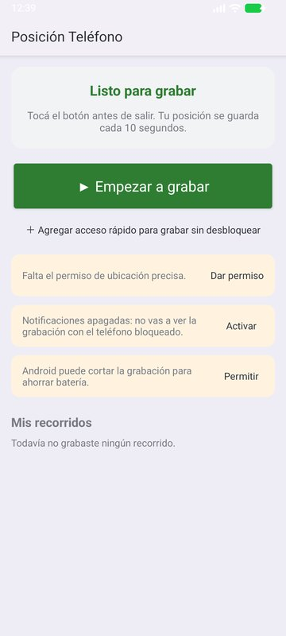
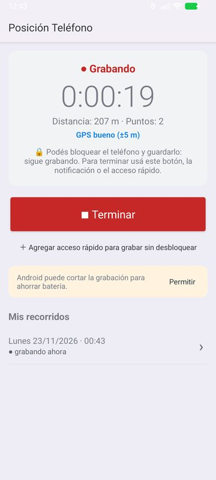
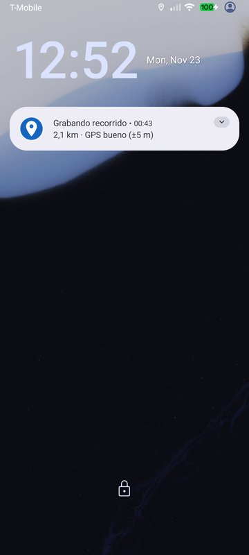
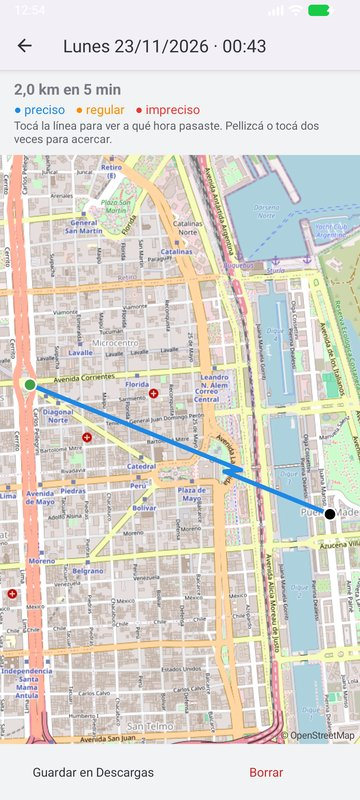

# Posición Teléfono

App Android que guarda tu posición GPS cada 10 segundos y después te muestra en un mapa por dónde anduviste. Está pensada para la bici: graba con el teléfono bloqueado en el bolsillo y es más precisa que la línea de tiempo de Google Maps.

<p align="center">
  
  
  
  
</p>

## Qué hace

- Guarda la hora, la posición, la precisión y la velocidad cada 10 s. Usa solo el GPS, sin mezclar wifi ni antenas.
- Sigue grabando con el teléfono bloqueado. En la pantalla de bloqueo se ven el tiempo, los km y un botón **Terminar** que no pide PIN.
- Muestra el recorrido sobre OpenStreetMap, coloreado según la precisión del GPS. Tocá la línea para ver a qué hora pasaste por ahí.
- Cada recorrido puede llevar un nombre, que le ponés después con **⋮** o desde el mapa. Desde ahí mismo también se borra definitivamente: el archivo desaparece del teléfono.
- Exporta CSV y GPX a `Descargas/PosicionTelefono`, con el nombre del recorrido en el archivo.
- No usa ninguna librería: el APK pesa unos 80 KB. Funciona en Android 12 o más nuevo y está pensada para el Moto G52.

## Instalar

1. Bajá el APK de [Releases](https://github.com/lucas-gio/posicion-telefono/releases/latest).
2. Abrilo en el teléfono y permití instalar apps de esa fuente.
3. Tocá **Empezar a grabar** y aceptá la ubicación precisa y las notificaciones. Si aparecen avisos naranjas, como el de batería, tocá su botón para resolverlos.

## Privacidad

Los recorridos quedan en el almacenamiento privado de la app. No van al backup ni pasan a otro teléfono, y solo salen si los exportás. La app usa internet únicamente para bajar el mapa, por HTTPS. La pantalla de bloqueo nunca muestra coordenadas.

## Desarrollo

```
./gradlew testDebugUnitTest lintDebug assembleRelease
```

El CI corre los tests y lint en cada push. La clave de firma va en `firma/` y no se sube a git.

Formato del CSV: `time,lat,lon,accuracy_m,speed_kmh,unix_ms` (hora local, decimales con punto).

Mapa © colaboradores de [OpenStreetMap](https://www.openstreetmap.org/copyright).
